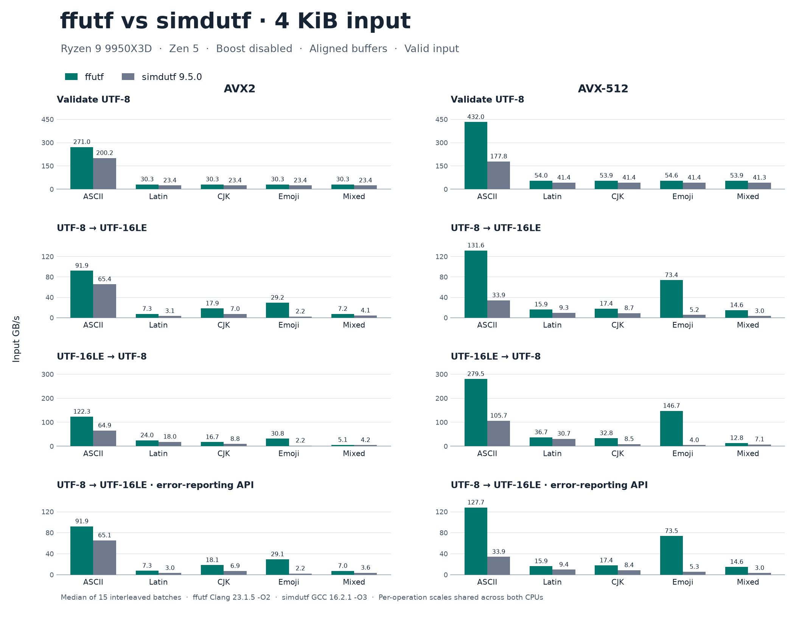
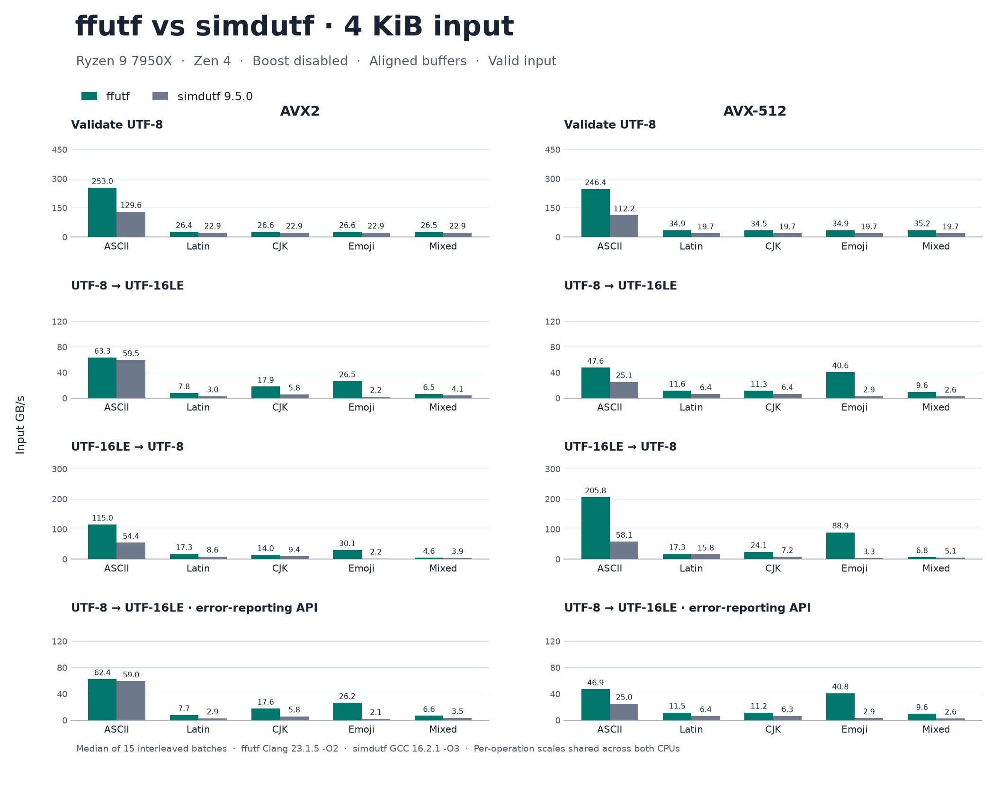
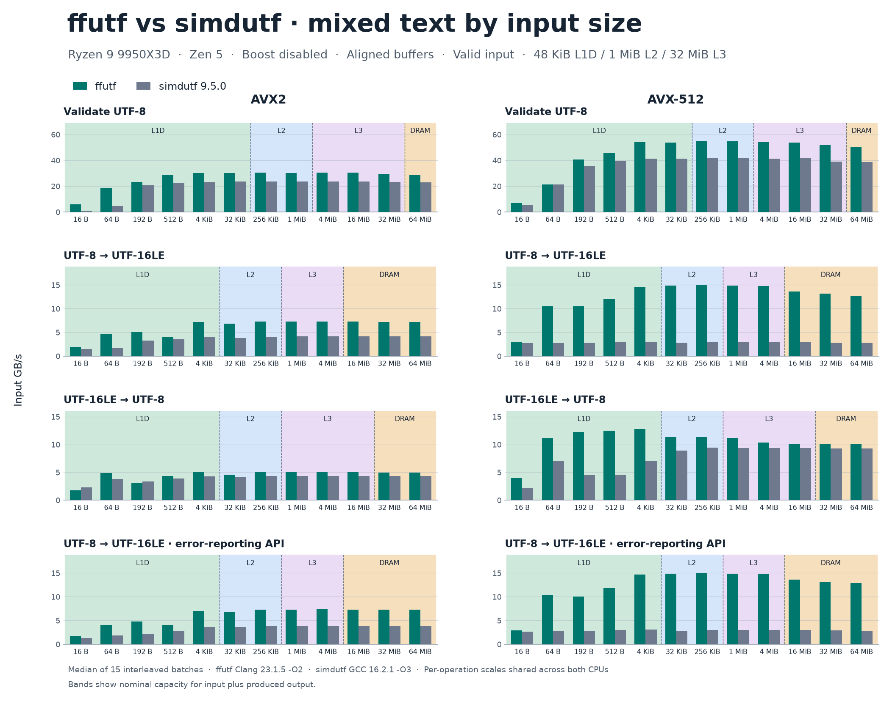
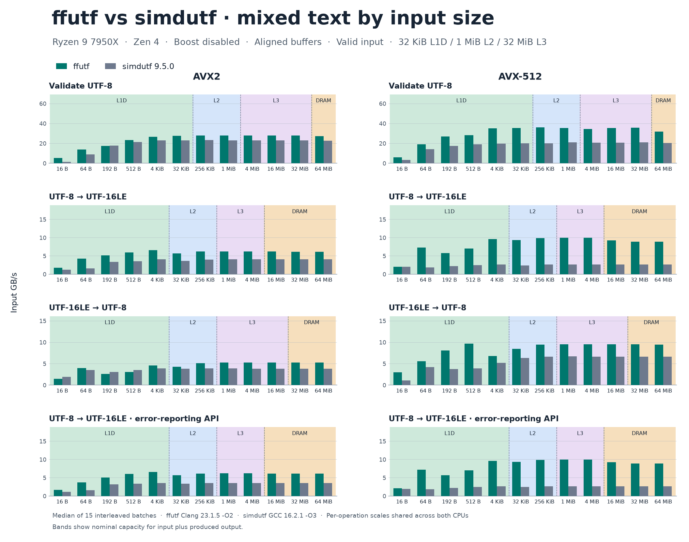

# ffutf

ffutf is a focused C99 experiment in strict UTF-8 validation and
bidirectional UTF-8/UTF-16LE conversion. It uses AVX2 and AVX-512
kernels, and both converters validate their input.

On an isolated Ryzen 9 9950X3D core with boost disabled, ffutf validates
4 KiB of mixed UTF-8 in **75.92 ns/call**, versus **99.06 ns/call**
for simdutf 9.5.0's AVX-512 backend. For 4 KiB of dense emoji,
AVX-512 UTF-8 to UTF-16LE conversion is **14.02× faster** on the 9950X3D
and **14.12× faster** on the 7950X.
[Benchmark charts and data](#charts-and-data)

| Input | ffutf (ns/call) | simdutf (ns/call) |
| ----- | --------------: | ----------------: |
| ASCII |            9.48 |             23.03 |
| Latin |           75.91 |             99.02 |
| CJK   |           75.94 |             99.02 |
| Emoji |           75.01 |             99.00 |
| Mixed |           75.92 |             99.06 |

The AVX-512 validator uses one lookup and a masked byte subtraction to
check second-byte bounds. The Zen 5 bulk loop carries a continuation mask
across blocks. Inputs shorter than 64 bytes use one masked load and
check the padded vector directly.

In the same matrix, ffutf validates 192 B and 512 B of aligned mixed UTF-8
in **4.72 ns/call** and **11.19 ns/call** on the 9950X3D. simdutf takes
**5.45 ns/call** and **13.00 ns/call** on those inputs.
[Short-input profiles](#short-input-profiles)

## AVX2 comparison

The forced AVX2 validator and simdutf 9.5.0's Haswell backend on the
9950X3D produced these median times per call with boost disabled.

| Input       | ffutf     | simdutf   |
| ----------- | --------: | --------: |
| 32 B mixed  |   2.55 ns |   5.11 ns |
| 4 KiB ASCII |  15.12 ns |  20.46 ns |
| 4 KiB mixed | 135.28 ns | 175.00 ns |
| 1 MiB mixed |  34.68 µs |  44.54 µs |

In a separate ffutf compiler comparison at `-O2`, GCC 16.2.1 and
Clang 23.1.5 both took 14.92 ns/call on 4 KiB ASCII. On mixed input,
Clang reduced the 32 B time from 3.02 to 2.61 ns/call, the 4 KiB time
from 157.02 to 135.44 ns/call, and the 1 MiB time from 38.20 to
34.73 µs/call.

The AVX2 kernel uses overlapping loads for long inputs and assembles a
zero-padded SIMD tail from bounded loads.

## Charts and data

The CSV gives per-call medians in nanoseconds and core cycles for all
tested placements from 16 B to 64 MiB. [Full results](results.csv)

The two-machine matrix compares ffutf and simdutf 9.5.0 on matching
AVX2 and AVX-512 backends on isolated cores with boost disabled. The
speedups use 4 KiB of valid input in aligned buffers and 15 interleaved
batches across three process launches.

| Operation                    | Input       | ISA                              | 9950X3D |  7950X |
| ---------------------------- | ----------- | -------------------------------- | ------: | -----: |
| Validate UTF-8               | ASCII       | [AVX2][validate-ascii-avx2]      |   1.35× |  1.95× |
| Validate UTF-8               | ASCII       | [AVX-512][validate-ascii-avx512] |   2.43× |  2.20× |
| Validate UTF-8               | Mixed       | [AVX2][validate-mixed-avx2]      |   1.29× |  1.16× |
| Validate UTF-8               | Mixed       | [AVX-512][validate-mixed-avx512] |   1.30× |  1.78× |
| UTF-8 → UTF-16LE             | Dense emoji | [AVX2][forward-emoji-avx2]       |  13.51× | 12.17× |
| UTF-8 → UTF-16LE             | Dense emoji | [AVX-512][forward-emoji-avx512]  |  14.02× | 14.12× |
| UTF-8 → UTF-16LE             | Mixed       | [AVX2][forward-mixed-avx2]       |   1.78× |  1.60× |
| UTF-8 → UTF-16LE             | Mixed       | [AVX-512][forward-mixed-avx512]  |   4.84× |  3.68× |
| UTF-16LE → UTF-8             | Dense emoji | [AVX2][reverse-emoji-avx2]       |  13.97× | 13.46× |
| UTF-16LE → UTF-8             | Dense emoji | [AVX-512][reverse-emoji-avx512]  |  36.49× | 26.61× |
| UTF-16LE → UTF-8             | Latin       | [AVX2][reverse-latin-avx2]       |   1.33× |  2.02× |
| UTF-16LE → UTF-8             | Latin       | [AVX-512][reverse-latin-avx512]  |   1.19× |  1.10× |
| UTF-8 → UTF-16LE with errors | Mixed       | [AVX2][forward-errors-avx2]      |   1.95× |  1.85× |
| UTF-8 → UTF-16LE with errors | Mixed       | [AVX-512][forward-errors-avx512] |   4.80× |  3.65× |

[validate-ascii-avx2]: https://github.com/vtlmks/ffutf/blob/27d47c56cb686fd6326510089068cba44f14958d/utf8_utf16le.h#L1027-L1035
[validate-ascii-avx512]: https://github.com/vtlmks/ffutf/blob/27d47c56cb686fd6326510089068cba44f14958d/utf8_utf16le.h#L841-L851
[validate-mixed-avx2]: https://github.com/vtlmks/ffutf/blob/27d47c56cb686fd6326510089068cba44f14958d/utf8_utf16le.h#L1044
[validate-mixed-avx512]: https://github.com/vtlmks/ffutf/blob/27d47c56cb686fd6326510089068cba44f14958d/utf8_utf16le.h#L831
[forward-emoji-avx2]: https://github.com/vtlmks/ffutf/blob/27d47c56cb686fd6326510089068cba44f14958d/utf8_utf16le.h#L1904
[forward-emoji-avx512]: https://github.com/vtlmks/ffutf/blob/27d47c56cb686fd6326510089068cba44f14958d/utf8_utf16le.h#L1577
[forward-mixed-avx2]: https://github.com/vtlmks/ffutf/blob/27d47c56cb686fd6326510089068cba44f14958d/utf8_utf16le.h#L1944
[forward-mixed-avx512]: https://github.com/vtlmks/ffutf/blob/27d47c56cb686fd6326510089068cba44f14958d/utf8_utf16le.h#L1393
[reverse-emoji-avx2]: https://github.com/vtlmks/ffutf/blob/27d47c56cb686fd6326510089068cba44f14958d/utf8_utf16le.h#L2824-L2840
[reverse-emoji-avx512]: https://github.com/vtlmks/ffutf/blob/27d47c56cb686fd6326510089068cba44f14958d/utf8_utf16le.h#L2391-L2424
[reverse-latin-avx2]: https://github.com/vtlmks/ffutf/blob/27d47c56cb686fd6326510089068cba44f14958d/utf8_utf16le.h#L2842-L2868
[reverse-latin-avx512]: https://github.com/vtlmks/ffutf/blob/27d47c56cb686fd6326510089068cba44f14958d/utf8_utf16le.h#L2470
[forward-errors-avx2]: https://github.com/vtlmks/ffutf/blob/27d47c56cb686fd6326510089068cba44f14958d/utf8_utf16le.h#L2155
[forward-errors-avx512]: https://github.com/vtlmks/ffutf/blob/27d47c56cb686fd6326510089068cba44f14958d/utf8_utf16le.h#L1567

### 4 KiB fixtures





### Mixed-text size sweep





## Long UTF-8 validation

The Zen 5 loop loads the current block and a view shifted forward by one byte,
then carries up to three expected continuation bits across blocks. It checks
for errors every block. The 7950X loop aligns the continuation tests with
three shifted predecessor loads.

In a matched profile of 4 KiB aligned mixed input on the 9950X3D,
the new loop took **327 core cycles/call**, down from **381**, versus **427**
for simdutf 9.5.0. Separate PMU runs on the same input counted about
190 cache-line-crossing loads per call before and 63 after, while retired
instructions increased from about 1,401 to 2,134 per call. The profiles used
the matrix compiler flags and CPU settings. The timing medians use three
131,072-call batches per implementation. The PMU counts cover the whole
profiling process and are divided by its call count.

For 4 KiB of mixed input with `0xff` at byte 0, median latency went from
1.86 to 3.02 ns/call. At byte 64 it went from 4.46 to 3.81 ns/call.

## UTF-8 to UTF-16LE

On 4 KiB of aligned dense emoji, the AVX-512 converter reaches
**73.4 GB/s** on the Ryzen 9 9950X3D and **40.6 GB/s** on the 7950X.
These are medians of 15 interleaved batches with boost disabled, using
Clang 23.1.5 at `-O2`. [Two-machine comparison](#charts-and-data)

Both SIMD paths validate while converting. The dense four-byte loops
check lead and continuation tags and reject out-of-range code points.
They extract the payload with two multiply-add stages and write surrogate
pairs directly. AVX2 handles eight code points per vector in
`ffutf__convert_utf16_nonascii_avx2_impl`. At the start of the input,
`ffutf__convert_utf16_dense_avx512` handles sixteen code points per vector and
loads the next four vectors ahead of the current group's stores. The
mixed-width path handles the remainder. In `ffutf__convert_utf16_block`,
a four-byte sequence emits its surrogate pair at the third and fourth
byte positions before byte compression packs the UTF-16 units in order.

In a before-and-after test on 4 KiB of aligned dense emoji, the dedicated
AVX-512 loop raised throughput from 10.0 to 73.4 GB/s on the 9950X3D
and from 3.8 to 40.4 GB/s on the 7950X. At 32 B, aligned ASCII in that
test went from 2.32 to 3.02 ns/call on the 9950X3D and from 2.91 to
3.82 ns/call on the 7950X. In the current matrix at 64 MiB, dense emoji
reaches 21.86 GB/s on the 9950X3D and 19.36 GB/s on the 7950X.

The simdutf 9.5.0 Haswell forward converter uses its table-driven path
for four-byte sequences and writes their surrogate pairs with scalar
stores. The dense emoji fixture exercises that path throughout the
input. [simdutf Haswell forward converter](https://github.com/simdutf/simdutf/blob/v9.5.0/src/haswell/avx2_convert_utf8_to_utf16.cpp)

The `_with_errors` variant uses the same SIMD loops. On failure, it finds
the start and type of the first malformed sequence. The scalar classifier
`ffutf__utf8_error` can backtrack to a lead byte that crosses the failing
block's boundary.

## UTF-16LE to UTF-8

Clang 23.1.5 at `-O2` versus simdutf 9.5.0's AVX-512 backend on the
9950X3D with boost disabled, 64-byte-aligned buffers, and 15 interleaved
batches across three launches.

**UTF-16 input throughput (GB/s)**

| Input       | 4 KiB ffutf | 4 KiB simdutf | 32 MiB ffutf | 32 MiB simdutf |
| ----------- | ----------: | ------------: | -----------: | -------------: |
| ASCII       |      279.47 |       105.69 |        62.86 |         51.15 |
| Latin       |       36.68 |        30.70 |        27.80 |         25.58 |
| CJK         |       32.78 |         8.48 |        12.50 |          9.66 |
| Dense emoji |      146.74 |         4.02 |        23.46 |          3.96 |
| Mixed       |       12.76 |         7.06 |        10.12 |          9.28 |

The AVX-512 ASCII loop checks and narrows 128 input units per iteration.
In the fixed-width dense surrogate loop, `VPMADDWD` combines the payload
of each validated pair. The AVX-512 loop writes four vectors at a time
and reads five vectors ahead of the stores. For 4 KiB of aligned dense
emoji, it reaches **146.7 GB/s** on the 9950X3D and **88.9 GB/s** on the
7950X.
[Output placement measurements](#reverse-conversion-and-output-placement)

Mixed blocks use byte compression and carry a boundary high surrogate
into the next block. The short path reads two vectors ahead of the
variable-length stores. Short runs of three-byte BMP code points use
fixed-width stores.

The 4 KiB AVX2 speedups against simdutf 9.5.0's Haswell backend use
aligned buffers.

| Input       | 9950X3D | 7950X  |
| ----------- | ------: | -----: |
| ASCII       |   1.88× |  2.11× |
| Latin       |   1.33× |  2.02× |
| CJK         |   1.90× |  1.49× |
| Dense emoji |  13.97× | 13.46× |
| Mixed       |   1.20× |  1.18× |

In the separate ffutf compiler comparison at 32 MiB on the 9950X3D,
dense emoji reached 21.63 GB/s with GCC and 21.76 GB/s with Clang.
For mixed text, GCC reached 7.71 GB/s and Clang reached 5.64 GB/s.

The AVX2 ASCII loop narrows 64 UTF-16 units per iteration.
`ffutf__store_surrogate_pairs_avx2` handles dense surrogate pairs.
In mixed blocks, each half of a pair supplies two UTF-8 bytes, so the
byte shuffles pack one, two, or three bytes per UTF-16 unit.
`ffutf__convert_utf16le_to_utf8_avx2` reads four Latin input vectors
ahead of its stores to reduce store-to-load conflicts at some placements.

The simdutf 9.5.0 Haswell reverse converter handles blocks containing
surrogates with a scalar loop. The dense emoji fixture exercises that
path throughout the input. [simdutf Haswell reverse converter](https://github.com/simdutf/simdutf/blob/v9.5.0/src/haswell/avx2_convert_utf16_to_utf8.cpp)

## Build and test

```sh
./build.sh
./bench --check
./bench --check-convert
./bench --check-with-errors
./bench --check-reverse
./bench
./bench --convert
./bench --with-errors
./bench --reverse
```

The check mode exercises all one- and two-byte inputs, truncated sequences,
and byte substitutions across vector boundaries at every input alignment.
The benchmark reports median ns/call for ASCII, Latin, CJK, emoji, and
mixed fixtures over three trials. When simdutf is enabled, the trial order
alternates between the implementations. The conversion benchmark reuses
output storage and checks every output unit after each timed batch.
UTF-8 to UTF-16LE batches run at least 128 calls. Reverse conversion
reports input GB/s and processes about 128 MiB of input per timed batch.

Build the [simdutf 9.5.0 release amalgamation](https://github.com/simdutf/simdutf/releases/tag/v9.5.0)
in its extracted directory.

```sh
c++ -std=c++17 -O3 -DNDEBUG -fPIC -shared simdutf.cpp -o libsimdutf.so
```

From the ffutf directory, set `SIMDUTF_DIR` to the directory containing
`simdutf_c.h`. If `libsimdutf.so` is in a separate directory, set
`SIMDUTF_LIB_DIR` to that directory.

```sh
SIMDUTF_DIR=/path/to/simdutf ./build.sh
./bench --check
./bench
```

For a direct comparison on Zen 5, build simdutf with just its AVX-512
backend enabled. This removes its runtime dispatch from the comparison.

```sh
c++ -std=c++17 -O3 -DNDEBUG -march=znver5 -fno-semantic-interposition -fPIC -shared \
  -DSIMDUTF_IMPLEMENTATION_HASWELL=0 -DSIMDUTF_IMPLEMENTATION_WESTMERE=0 \
  -DSIMDUTF_IMPLEMENTATION_FALLBACK=0 -DSIMDUTF_USE_STATIC_INITIALIZATION=1 \
  simdutf.cpp -o libsimdutf.so
```

With the AVX-512 simdutf build above, enable the full reverse size sweep
through 32 MiB of input.

```sh
CC=clang SIMDUTF_DIR=/path/to/simdutf CFLAGS="-O2 -Wall -Wextra -DFFUTF_BENCH_LARGE" ./build.sh
./bench --reverse
```

To compare the AVX2 kernels, rebuild the amalgamation with
`SIMDUTF_IMPLEMENTATION_ICELAKE=0` in place of
`SIMDUTF_IMPLEMENTATION_HASWELL=0` and omit `-march=znver5`. Then run

```sh
SIMDUTF_DIR=/path/to/simdutf CFLAGS="-O2 -Wall -Wextra -DFFUTF_BENCH_AVX2" ./build.sh
./bench --check
./bench
./bench --check-convert
./bench --convert
./bench --check-with-errors
./bench --with-errors
./bench --check-reverse
./bench --reverse
```

Define `FFUTF_BENCH_LARGE` alongside `FFUTF_BENCH_AVX2` to extend the
reverse sweep through 32 MiB.

## Use the kernel

Define `FFUTF_IMPLEMENTATION` in one C translation unit and include
[utf8_utf16le.h](utf8_utf16le.h). The validator selects AVX-512 VBMI,
AVX2, or scalar code at runtime. It accepts arbitrary alignment, embedded
NUL, and empty input. Reads stay within the byte span.

```c
#define FFUTF_IMPLEMENTATION
#include "utf8_utf16le.h"

bool valid = ffutf_validate_utf8(buf, len);
size_t units = ffutf_convert_utf8_to_utf16le(buf, len, output);
struct ffutf_result result = ffutf_convert_utf8_to_utf16le_with_errors(buf, len, output);
size_t bytes = ffutf_convert_utf16le_to_utf8(utf16_input, unit_count, utf8_output);
```

Give the converter a disjoint buffer with room for `len` UTF-16 code units.
It returns the number written, or `SIZE_MAX` for invalid UTF-8. The
converter selects AVX-512 VBMI with VBMI2, AVX2, or scalar code.
Both SIMD conversion paths use POPCNT.

The error-reporting variant takes the same buffers. If `result.error`
is `FFUTF_SUCCESS`, `result.count` is the output count in UTF-16 units.
Otherwise, `result.count` is the input byte offset of the first malformed
sequence and `result.error` identifies its type.

For UTF-16LE to UTF-8, pass the input length in 16-bit code units and a
disjoint output buffer with room for three bytes per unit. The function
returns the byte count or `SIZE_MAX` for an invalid surrogate sequence.
It selects AVX-512 VBMI and VBMI2 with POPCNT, then AVX2 with BMI2 and
POPCNT, and falls back to scalar code.

## Reverse conversion and output placement

In `ffutf__convert_utf16le_to_utf8_avx512`, the fifth read-ahead vector covers the +256 B output placement on the 7950X, where four vectors of read-ahead alone reached about 41 GB/s.

An earlier comparison of the original and pipelined AVX-512 loops used
4 KiB of dense surrogate pairs with both buffers cache-line aligned. The
matrix harness's `--profile` mode measured median input throughput
across five interleaved batches with boost disabled.

| CPU             | Output shift | Original (GB/s) | Pipelined (GB/s) |
| --------------- | -----------: | --------------: | ---------------: |
| Ryzen 9 9950X3D |          0 B |           55.85 |           147.02 |
| Ryzen 9 9950X3D |       +128 B |           59.22 |           146.93 |
| Ryzen 9 9950X3D |       +256 B |           59.22 |           147.02 |
| Ryzen 9 7950X   |          0 B |            7.33 |            89.03 |
| Ryzen 9 7950X   |       +128 B |           19.79 |            87.90 |
| Ryzen 9 7950X   |       +256 B |           29.90 |            88.22 |

On the 7950X, pipelining reduced store-to-load conflicts from 31.84 to
1.68 conflicts/call at the original placement and from 29.61 to
1.12 conflicts/call at +256 B. The counts cover the full profiling process
and are divided by its number of calls.

In the interleaved comparison, 4 KiB reverse ASCII, Latin, CJK, and mixed throughput stayed within 1.6% of the original loop on both CPUs.

### AVX2 reverse conversion at 192 B

On mixed UTF-16LE, shifting just the output by 128 B cut latency and
store-to-load conflicts at essentially the same retired instruction
count. Staging all six input vectors before writing output narrowed the
timing range across aligned, +128 B, and split-line placements. Each
number is the median of three profiles on an isolated core with boost
disabled.

| CPU     | Aligned → +128 B (ns/call) | Aligned → +128 B (conflicts/call) | Read-ahead range (ns/call) |
| ------- | -------------------------: | --------------------------------: | -------------------------: |
| 9950X3D |              60.85 → 36.44 |                       7.24 → 2.87 |                33.17–33.62 |
| 7950X   |              74.03 → 41.38 |                      29.07 → 7.88 |                37.45–38.96 |

The revised read-ahead dispatch also increased 30 B mixed latency on
the 9950X3D. The current converter uses the original mixed-block loop.

### Pipeline restarts on short AVX-512 reverse conversion

A 114 B UTF-16LE input with 28 surrogate pairs followed by one ASCII code
unit exposed a store-to-load alias across repeated calls. The short path
loads a 64 B block and a masked 50 B tail before storing the output. At
the standard placement, the masked load and the previous call's first
output store both start at page offset `0x280` in disjoint buffers. The
input starts at `0x240`, and the pointers are 64 MiB + 64 B apart.
[Short AVX-512 path](utf8_utf16le.h#L2536)

The probe reused the matrix fixtures, buffer layout, and output checks.
It timed ffutf's public entry point on Ryzen 9 9950X3D logical CPU 9 with
boost enabled and `SCHED_OTHER` on Linux 7.3.4. ffutf used Clang 23.1.5
at `-O2`, interleaved with simdutf 9.5.0's Ice Lake backend built by GCC
16.2.1 at `-O3`. The table pools five batches per placement across six
launches, with 36,792 calls per batch. Within each launch, the input
address stays fixed as the output shifts.

| Output shift | Time (ns/call) | Core cycles/call | Store-to-load conflicts/call | Resync redirects/call |
| -----------: | -------------: | ---------------: | ---------------------------: | --------------------: |
|          0 B |          26.71 |           152.25 |                         0.50 |                  1.50 |
|        +64 B |           5.51 |            31.16 |                         0.00 |                  0.00 |
|       +4 KiB |           5.58 |            31.18 |                         0.49 |                  0.00 |
|      +64 KiB |          26.92 |           152.25 |                         0.50 |                  1.50 |

All four placements retired about 163 instructions per call and fewer
than 0.001 branch misses per call. Moving the output by 64 B removed
121 cycles per call, about 80% of the slow case's cycle count. Moving
it by 4 KiB preserved the page offset and nearly all the store-to-load
conflicts while removing the resync redirects. The probe counted the
events in user space with PMCx024 umask `0x02` for conflicts and PMCx09F
umask `0x01` for redirects from pipeline restarts.
[Zen 5 load/store events](https://raw.githubusercontent.com/torvalds/linux/master/tools/perf/pmu-events/arch/x86/amdzen5/load-store.json) · [Zen 5 resync event](https://lkml.iu.edu/2405.0/02414.html)

Shifting both buffers together reproduced the slow case at several
offsets. An `mfence` between calls drained pending stores and eliminated
the resync redirects at the original addresses. Replacing only the output
backing page with a fresh 4 KiB anonymous page at the same virtual address
eliminated the redirects in five of six launches. Page backing can change
which timing regime appears even at fixed virtual addresses.

## Short-input profiles

These earlier ffutf optimization profiles used simdutf 9.4.0 as a
matched control. For 256 B of Latin input, shifting the AVX-512 reverse
converter's output by 256 B changed both latency and the store-to-load
conflict rate.

- **Ryzen 9 9950X3D.** ffutf went from 12.56 to 8.36 ns/call, and simdutf
  went from 13.46 to 10.68 ns/call. ffutf went from 9.80 to 1.19
  store-to-load conflicts/call.
- **Ryzen 9 7950X.** ffutf went from 17.26 to 11.72 ns/call, and simdutf
  went from 34.74 to 15.07 ns/call. ffutf went from 22.27 to 3.51
  store-to-load conflicts/call.

For 64 B to 1 KiB, ffutf's AVX-512 validator applies continuation and second-byte bounds checks to each vector, carries up to three expected continuation bits across vectors, and reduces errors at the end. The short reverse loop uses bounded loads and falls back to the general tail for the final partial vector. Short ASCII runs can narrow three overlapping vectors.

The tables report median latency across three interleaved batches.

**Ryzen 9 9950X3D**

| Fixture                            | Earlier ffutf (ns/call) | Updated ffutf (ns/call) | simdutf (ns/call) |
| ---------------------------------- | ----------------------: | ----------------------: | ----------------: |
| Validate 192 B mixed, aligned      |                    7.90 |                    4.60 |              5.63 |
| Validate 512 B mixed, aligned      |                   16.85 |                   11.55 |             13.52 |
| Reverse 192 B ASCII, aligned       |                    4.60 |                    3.47 |              6.92 |
| Reverse 192 B CJK, aligned         |                    7.66 |                    4.88 |             23.26 |
| Reverse 512 B CJK, aligned         |                   17.68 |                    9.61 |             49.30 |
| Reverse 512 B Latin, split lines   |                   19.42 |                   16.45 |             23.81 |
| Reverse 192 B mixed, output +128 B |                   15.21 |                   15.38 |             19.71 |
| Reverse 512 B mixed, split lines   |                  101.81 |                   41.11 |             54.43 |

**Ryzen 9 7950X**

| Fixture                            | Earlier ffutf (ns/call) | Updated ffutf (ns/call) | simdutf (ns/call) |
| ---------------------------------- | ----------------------: | ----------------------: | ----------------: |
| Validate 192 B mixed, aligned      |                   10.43 |                    7.07 |             11.60 |
| Validate 512 B mixed, aligned      |                   21.91 |                   18.27 |             28.78 |
| Reverse 192 B ASCII, aligned       |                    9.04 |                    8.80 |              9.67 |
| Reverse 192 B CJK, aligned         |                   15.80 |                   13.97 |             42.19 |
| Reverse 512 B CJK, aligned         |                   38.95 |                   33.97 |             86.98 |
| Reverse 512 B Latin, split lines   |                   45.84 |                   21.89 |             49.86 |
| Reverse 192 B mixed, output +128 B |                   33.92 |                   26.52 |             28.68 |
| Reverse 512 B mixed, split lines   |                  111.39 |                   55.61 |            128.44 |

The 512 B mixed UTF-8 validation runs on Zen 5 also recorded hardware
counters.

| Metric                    | Earlier ffutf | Updated ffutf | simdutf |
| ------------------------- | ------------: | ------------: | ------: |
| Core cycles/call          |          72.6 |          49.7 |    58.2 |
| Retired instructions/call |           253 |           310 |     320 |

All three profiles recorded fewer than 0.1 branch misses/call.

For the Zen 4 split-line 512 B Latin reverse case, the counter dropped
from 12.31 to 3.27 store-to-load conflicts/call.

The CSV gives the minimum and maximum ns/call across batches for each
case. Exact relative placements matter for short conversion benchmarks.

## SIMD boundary checks

The forward ASCII path loads both ends of a short buffer before widening. The reverse AVX2 path narrows an eight-word ASCII suffix in SIMD after converting its mixed prefix. The AVX2 validator returns directly when the ASCII loop consumes the whole input.

These earlier ffutf optimization profiles used simdutf 9.4.0 as a
matched control. The tables report median latency across five interleaved
batches.

**Ryzen 9 9950X3D**

| Fixture                      | Earlier ffutf (ns/call) | Updated ffutf (ns/call) | simdutf (ns/call) |
| ---------------------------- | ----------------------: | ----------------------: | ----------------: |
| AVX-512 validate 129 B mixed |                    5.19 |                    3.95 |              4.38 |
| AVX-512 forward 65 B ASCII   |                    3.55 |                    2.86 |              6.29 |
| AVX-512 reverse 192 B emoji  |                    5.68 |                    3.08 |             31.61 |
| AVX-512 reverse 66 B CJK     |                    7.65 |                    6.03 |             11.22 |
| AVX2 validate 128 B ASCII    |                    2.32 |                    1.39 |              2.78 |
| AVX2 forward 129 B ASCII     |                    3.18 |                    3.03 |              7.90 |
| AVX2 reverse 30 B mixed      |                    9.27 |                    7.90 |              7.76 |

**Ryzen 9 7950X**

| Fixture                      | Earlier ffutf (ns/call) | Updated ffutf (ns/call) | simdutf (ns/call) |
| ---------------------------- | ----------------------: | ----------------------: | ----------------: |
| AVX-512 validate 129 B mixed |                    7.16 |                    5.46 |              8.59 |
| AVX-512 forward 65 B ASCII   |                   10.07 |                    4.96 |             11.81 |
| AVX-512 reverse 192 B emoji  |                   21.04 |                    9.93 |             60.81 |
| AVX-512 reverse 66 B CJK     |                   17.77 |                    9.63 |             22.16 |
| AVX2 validate 128 B ASCII    |                    3.16 |                    1.35 |              3.61 |
| AVX2 forward 129 B ASCII     |                    8.19 |                    6.44 |             10.99 |
| AVX2 reverse 30 B mixed      |                   13.24 |                   10.28 |             10.11 |

In separate counter runs on the 7950X, 65 B ASCII widening went from
19.86 to 4.10 store-to-load conflicts/call. The 66 B CJK reverse
conversion went from 23.25 to 9.83 store-to-load conflicts/call.
Moving the final loads ahead of the first stores helps both boundaries.

At 130 B of aligned AVX2 mixed reverse input on the 9950X3D, the current
matrix gives 39.65 ns/call for ffutf and 31.46 ns/call for simdutf 9.5.0.
ffutf packs variable-width output into groups and copies the final
block's exact byte count from a temporary buffer. Replacing that copy
with overlapping vector loads and stores gave inconsistent results
across the two CPUs.

## Run-to-run variation

Each chart pools 15 interleaved batches from three independent launches.
Comparing the first two AVX-512 launches, 203 of 2,772 benchmark series
on the 9950X3D and 335 on the 7950X differed by more than 5%. Pooling
launches reduces the weight of a single process's results. The CSV
retains the full range of batch times for each series.

On the 9950X3D, the same ffutf executable measured 403.5 GB/s for aligned
4 KiB ASCII validation under a boot without isolation and 431.6 GB/s with
the benchmark isolation settings restored. Core cycles per call fell from
about 44 to 41, and individual launches reached 434.3 GB/s. Both runs
used CPU 9 with boost disabled and the same kernel and microcode.

Earlier matched reruns of two ffutf builds on the 7950X put the median change within 1% for Latin and mixed validation and ASCII and mixed forward conversion, across all placements at 4 KiB and above. Rerunning the same binary recovered the earlier throughput. At 192 B, the updated validator in that comparison took one to two more cycles per call on mixed text and retired one additional instruction per call. Moving the text and the buffers separately preserved that difference.

In an earlier 9950X3D profile, moving simdutf 9.4.0's 4 KiB emoji output
by 256 B raised reverse throughput from 7.94 to 9.91 GB/s. The counter
dropped from 43.40 to 0.23 store-to-load conflicts/call at the same
retired instruction count per call. The corresponding CJK shift changed
throughput from 12.25 to 12.63 GB/s. The earlier 8.28 GB/s CJK and
4.01 GB/s emoji measurements did not recur across matched builds, buffer
shifts, or the page-mapping controls.

In the previous 9950X3D matrix, simdutf 9.5.0's aligned 4 KiB dense
emoji reverse batches ranged from 606 to 1,025 ns/call. In the current
three launches on isolated cores, its launch medians were 1,018 to
1,019 ns/call. Moving the output by 128 B brought the pooled median to
765.5 ns/call. ffutf stayed near 27.9 ns/call in both matrices, so the
larger speedup reflects simdutf's timing shift.

## Reproduce the comparison

`matrix.c` uses the project header and reuses the fixtures from `bench.c`. Run the comparison commands from the repository root.

Download the [simdutf 9.5.0 release amalgamation](https://github.com/simdutf/simdutf/releases/tag/v9.5.0) and extract it outside the repository. The release's `singleheader.zip` SHA-256 is `8f18779b5605ab3ce2f8e4a1abb409c64253f22403207732365e305d0d6e8025`.

```sh
bench_dir=$(mktemp -d "${TMPDIR:-/tmp}/ffutf-matrix.XXXXXXXX")
./build-matrix.sh /path/to/simdutf "$bench_dir/build"
for isa in avx2 avx512; do
    for mode in check check-convert check-reverse check-with-errors; do
        "$bench_dir/build/check-$isa" "--$mode"
    done
done
```

The measured build used Clang 23.1.5 at `-O2` for ffutf and GCC 16.2.1 at `-O3` for simdutf. Each simdutf library contains one backend, Haswell for AVX2 and Ice Lake for AVX-512. The benchmark calls ffutf's corresponding kernels directly. The simdutf timings use its public C entry points, including the result conversion in its error-reporting entry point. The same binaries and shared libraries ran on both CPUs. The measured header SHA-256 is `003e6d21ab183adc9cb3a55ef02d4ca7a7ff7451b898d5c46529fe3b7305366f`.

Both hosts used boost disabled, the `performance` governor, and
`SCHED_OTHER`. The 9950X3D ran on CPU 9 under Linux 7.3.4-arch1-1 with
CPUs `9-11,25-27` isolated. The 7950X ran on CPU 1 under Linux
7.3.5-arch1-1 with CPUs `1,5,7,17,21,23` isolated. Both boots used
`isolcpus=domain,managed_irq` with the indicated mask, and used the same
mask for `nohz_full` and `rcu_nocbs`. Default IRQ affinity covered the
other CPUs.

Set `CPU` to an isolated logical CPU on the test host and enable access to Linux user-space cycle counters. Use the machine label `zen4` or `zen5` for `HOST`.

```sh
for launch in 1 2 3; do
    mkdir -p "$bench_dir/captures/$launch"
    for isa in avx2 avx512; do
        taskset -c "$CPU" chrt -o 0 "$bench_dir/build/matrix-$isa" > "$bench_dir/captures/$launch/$HOST-$isa.csv"
    done
done
```

Collect the captures from both hosts under the same capture directory.
Summarize the results and draw the charts with Bash.

```bash
python3 summarize.py results.csv "$bench_dir"/captures/*/zen{4,5}-avx{2,512}.csv
python3 chart.py results.csv charts
```

The harness reports elapsed `CLOCK_MONOTONIC_RAW` time and PMU core cycles in user mode. Each launch runs five batches per implementation with alternating implementation order. The summary pools the batches from each launch and reports the median. The harness poisons output before a batch, checks each call's result, and checks the output bytes and a canary afterward. The cycle readout rejects multiplexed intervals. Both cache summaries use the input plus produced output as a nominal working set on a 32 MiB CCD.

Each ISA and host has 1,380 valid cases and six malformed-input cases. Input length is in bytes, including for UTF-16LE. The standard aligned conversion case uses input and output at page offsets `0x240` and `0x280`, with their addresses separated by 64 MiB + 64 B. The second placement moves output 128 B while preserving cache-line alignment. The split placement offsets the buffers to straddle cache lines and keeps the UTF-16LE pointer 2-byte aligned. Validation alone uses input offsets 0, 32, and 63 bytes.

These charts used Matplotlib 3.11.2 and NumPy 2.5.5.

The error-reporting API runs on valid inputs throughout the main matrix. Six separate cases replace the first, middle, or final byte of a 4 KiB or 1 MiB ASCII input with `0xff`. Compare these rows using ns/call or cycles/call since the amount of input scanned depends on where the error occurs.

Run the targeted AMD PMU cases with `./profile-matrix.sh "$bench_dir/build" "$CPU"`. This uses the raw store-to-load conflict event `0x24`, umask `0x02`, alongside cycles, instructions, and branch misses. Counts cover the profiling process and are normalized by its call count.

For the three targeted dense-surrogate placements, use `"$bench_dir/build/matrix-avx512" --profile 2 3 4096 0 "$SHIFT" 0` with `SHIFT` set to 0, 128, or 256 under the same CPU affinity.

## License

[MIT](LICENSE).
